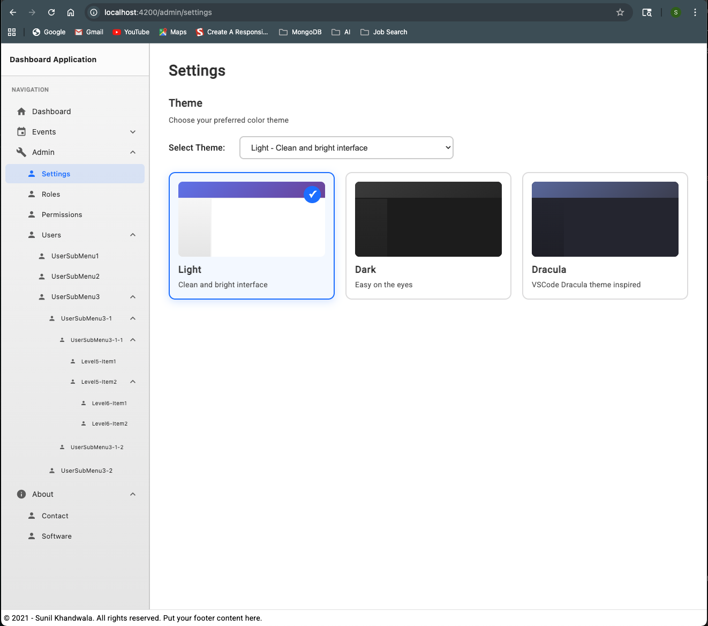
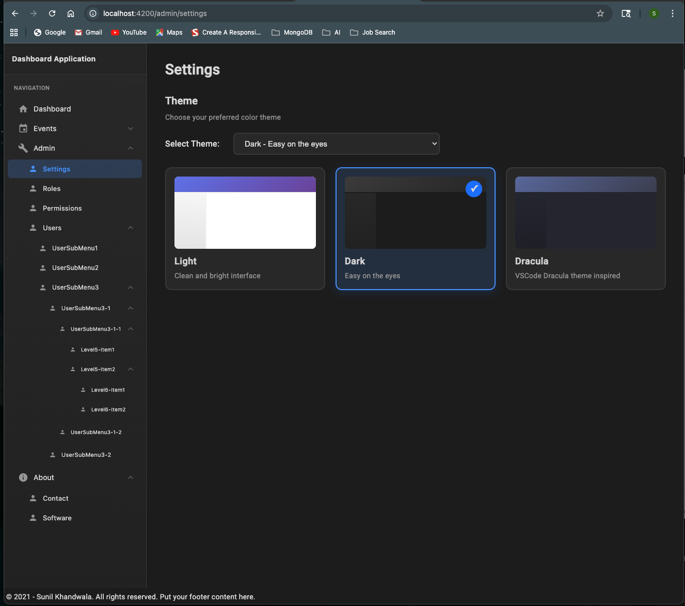
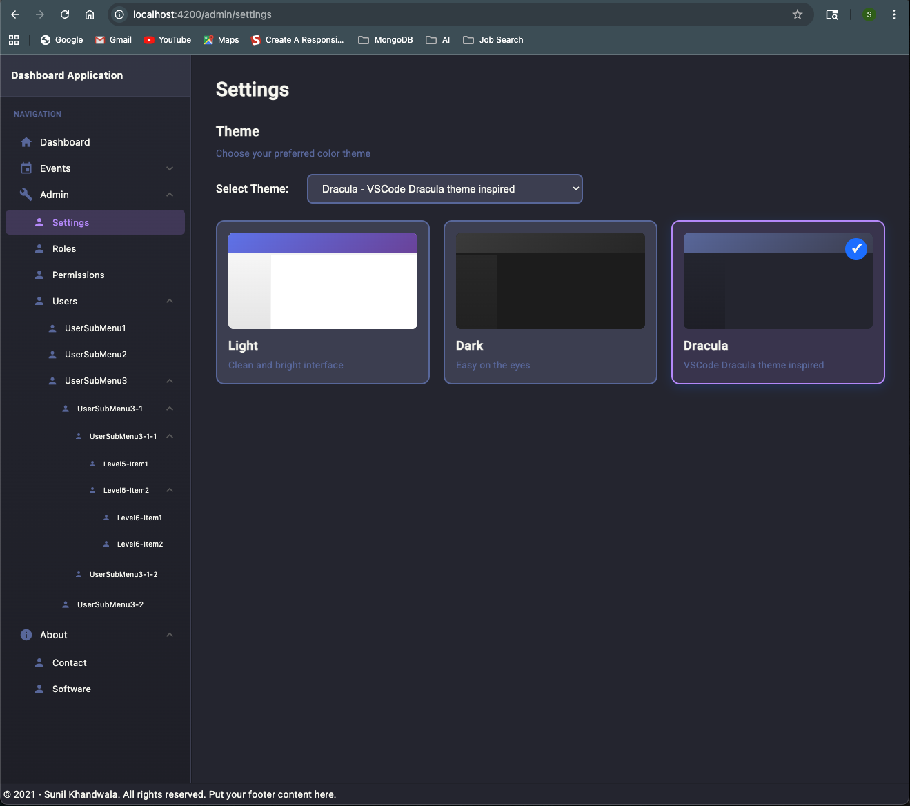

# AngularDashboardTemplate

A standalone Angular 21 + Electron dashboard template with Angular Material UI, three built-in themes, local RxDB storage, and a resizable sidebar. Use it as a starting point for any admin dashboard or data management application.

## Screenshots

| Light | Dark | Dracula |
|-------|------|---------|
|  |  |  |

> Replace screenshots with your own after customization.

## What's Included

- **Standalone components** — no NgModules, Angular 21 latest patterns
- **Angular Material** — sidenav layout, icons, buttons, dividers, toolbar
- **Three themes** — Light, Dark, Dracula (CSS custom properties + Material overrides)
- **Resizable sidebar** — drag to resize (150–500px), width persisted in localStorage
- **Local database** — RxDB with Dexie (IndexedDB) storage, schema-validated
- **Electron desktop** — packaged for Windows (NSIS), macOS (DMG), Linux (AppImage)
- **TypeScript strict mode** — full type safety
- **Unit tests** — Jasmine + Karma test suite

## Quick Start

### Prerequisites

- Node.js LTS (v22+)
- npm v10+

### As a new project

```bash
# 1. Clone/fork this repo
git clone <this-repo> my-dashboard
cd my-dashboard

# 2. Run the setup script
node scripts/setup.js

# 3. Install dependencies
npm install

# 4. Start the dev server
npm run start
```

### As-is (development)

```bash
npm install
npm run start
# Navigate to http://localhost:4200
```

## Customization

### Config service (recommended)

Edit `src/app/config/app.config.overrides.ts` to change:

- `appName` / `appTitle` — browser tab title
- `author` — footer copyright text
- `defaultTheme` — `light`, `dark`, or `dracula`
- `sidebarHeader` — text in the sidebar top bar
- `databaseName` — RxDB database identifier
- `menuItems` — sidebar navigation structure
- `electronAppId` / `electronProductName` — Electron packaging

### Full setup script

`node scripts/setup.js` prompts for project metadata and updates `package.json`, `angular.json`, `main.js`, environment files, and the overrides file automatically.

### Themes

Themes are applied via CSS class on `<body>`. The settings page (`/settings`) provides a UI for switching. Theme preference persists in localStorage. To add a new theme:

1. Add a `body.theme-<name>` block in `src/styles.scss`
2. Add the theme ID to the `themes` array in `SettingsComponent`
3. Add it to the `defaultTheme` union type in `app.config.model.ts`

### Adding pages

```bash
ng generate component features/my-page --standalone
```

Then add a route in `src/app/app.routes.ts` and a menu item in `app.config.overrides.ts`.

## Commands

| Command | Description |
|---------|-------------|
| `npm run start` | Dev server (localhost:4200) |
| `npm run build` | Production build |
| `npm run test` | Unit tests with coverage |
| `npm run electron` | Electron desktop app (dev) |
| `npm run electron-build` | Package desktop app |
| `npm run electron-build-win` | Windows NSIS installer |
| `npm run electron-build-mac` | macOS DMG |
| `npm run electron-build-linux` | Linux AppImage |

## Project Structure

```
src/app/
├── config/                 # ★ Central configuration layer
├── features/               # Feature pages (dashboard, users, admin, etc.)
├── layouts/                # Layout components (default sidenav)
└── shared/                 # Reusable components and services
```

See `CLAUDE.md` for detailed architecture documentation.

## License

MIT
